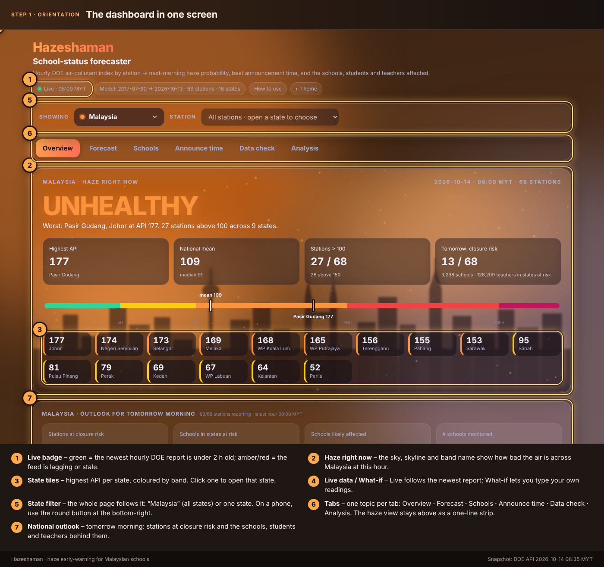
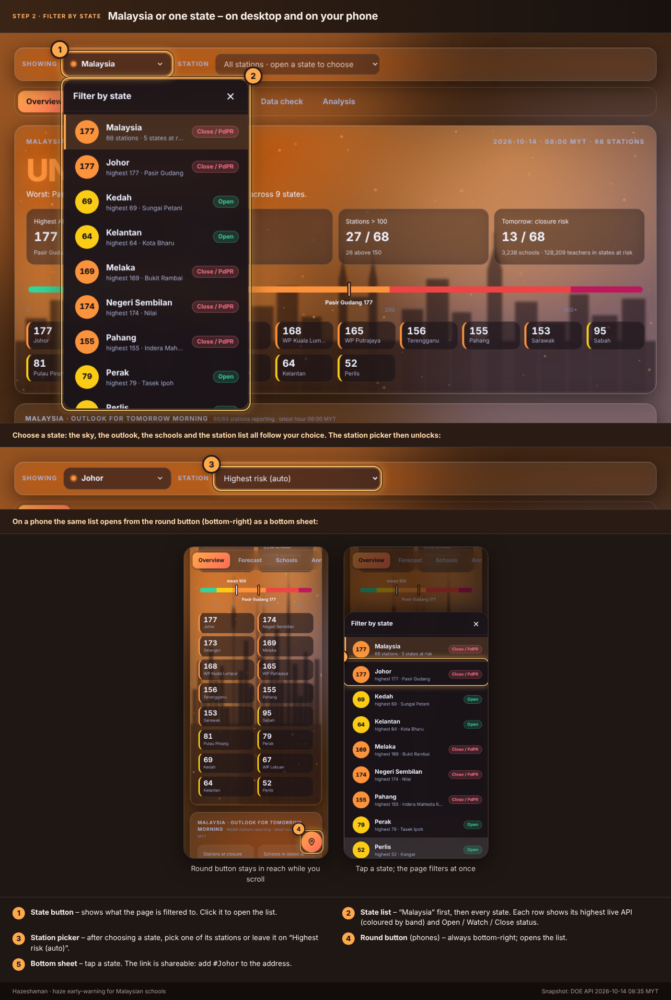
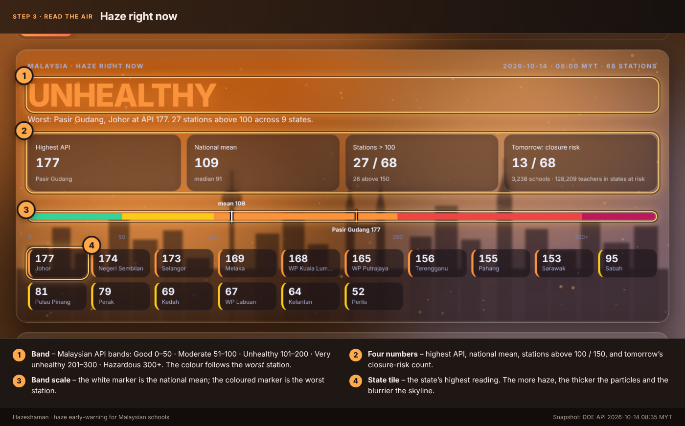
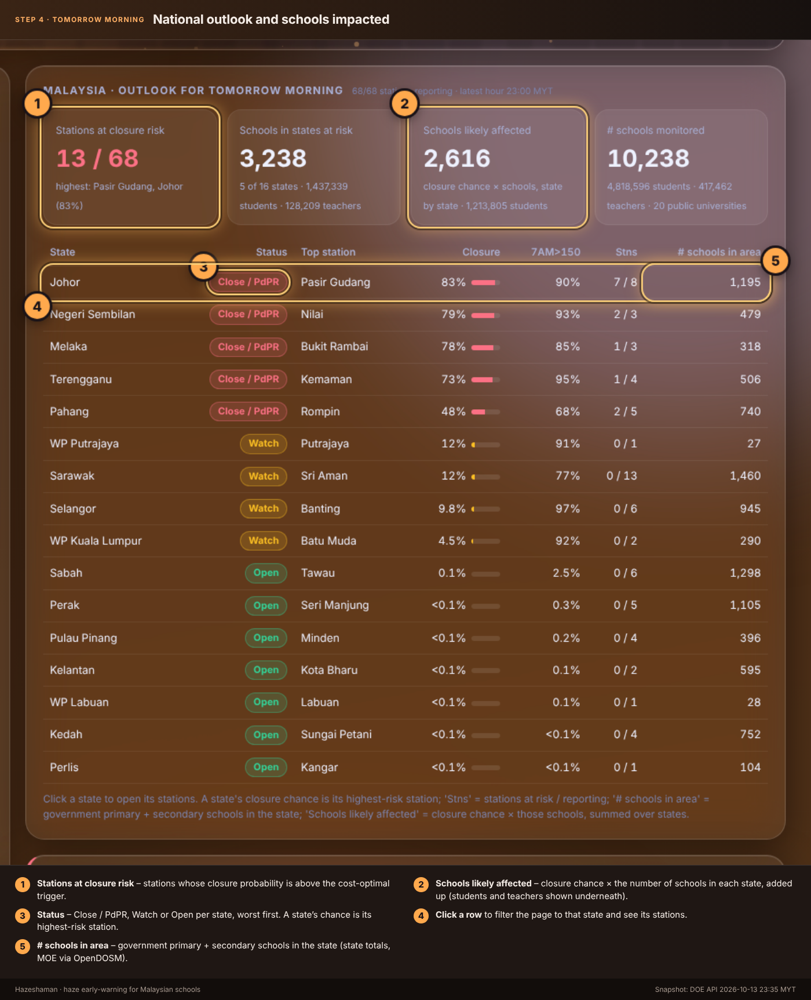
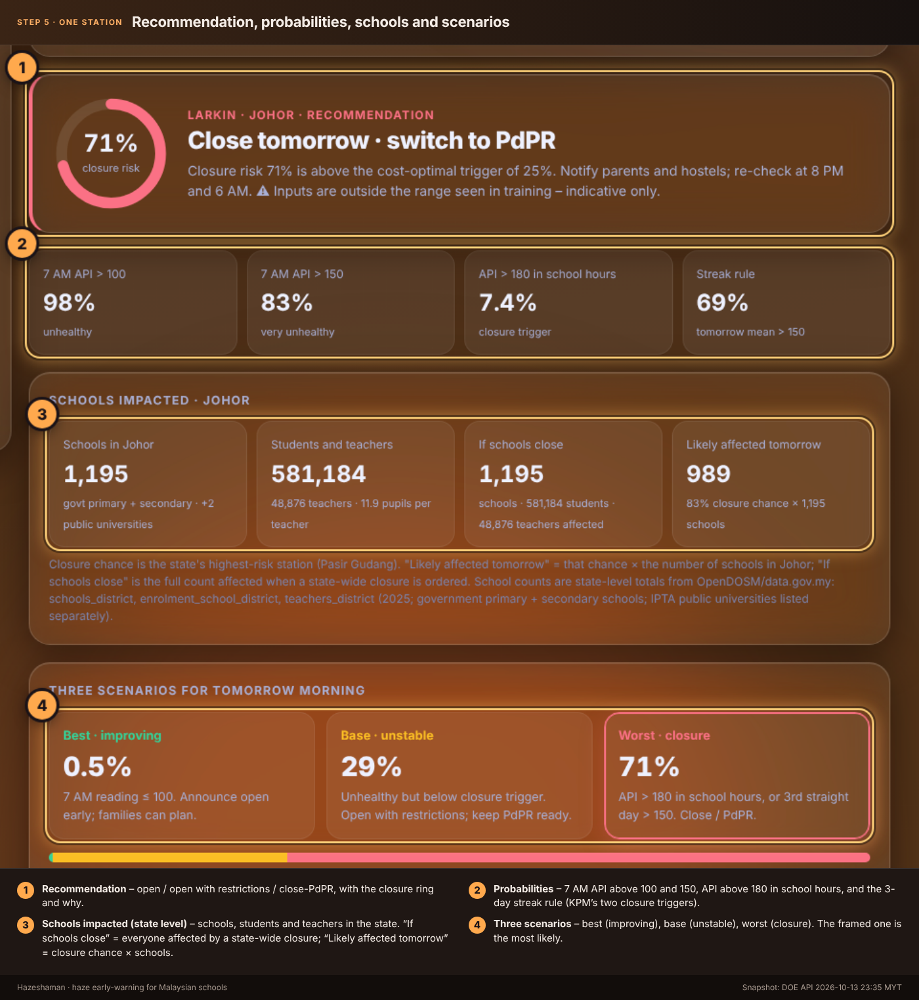
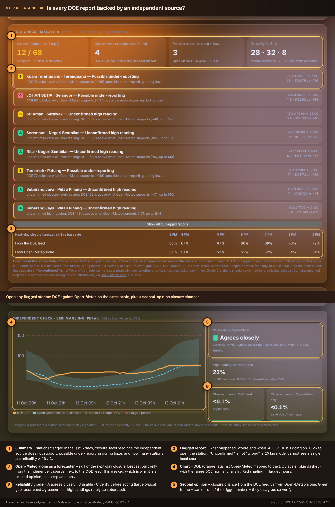
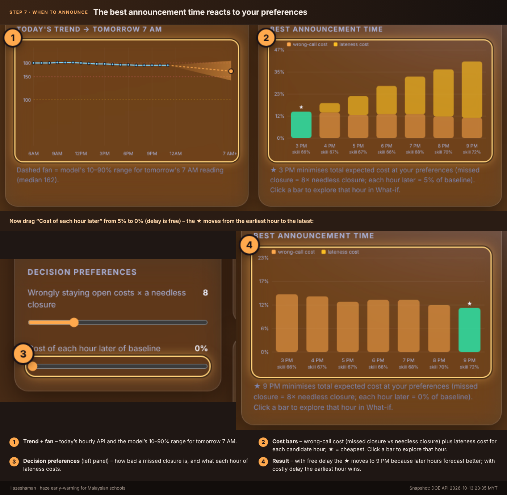
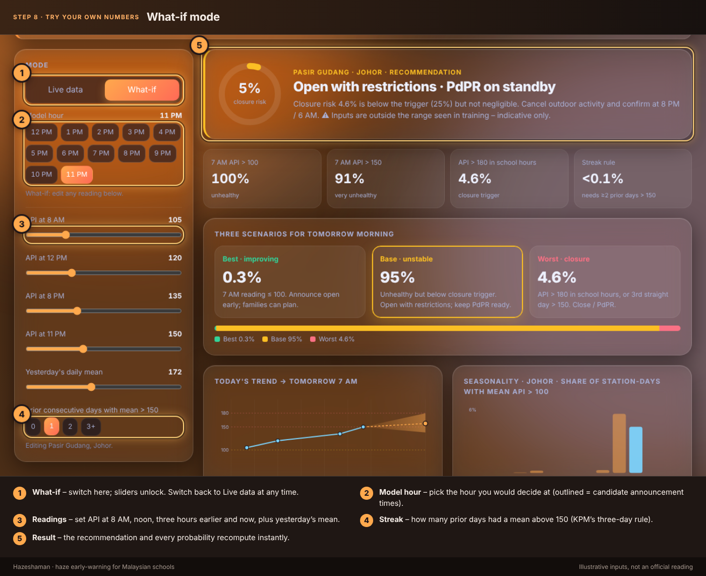
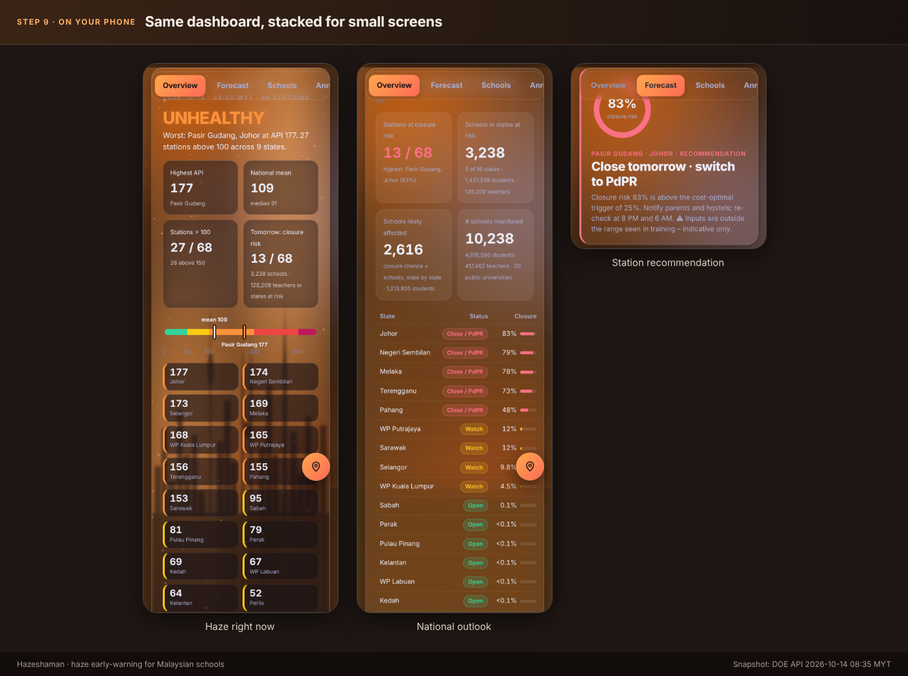

# Hazeshaman

**Haze early-warning and school-status decision support for Malaysia.**
It turns the DOE hourly air-pollutant index (API / IPU) of every monitoring station into a
probability that schools will have to close tomorrow, tells you the best time to announce it,
and counts the schools, students and teachers affected.

* `docs/index.html` - the dashboard (static) · `docs/guide.html` - illustrated how-to (`/guide`)
* `docs/outlook.json` and `docs/history.json` - the seven-day outlook models and the daily history behind the 7-day outlook tab (`python -m hazeshaman.outlook`; `python -m hazeshaman.histfile update` folds in new days daily)
* `docs/analysis/` - the consolidated written analysis (data, model, announcement time, Open-Meteo cross-check, school impact, closure decisions), generated by `python -m hazeshaman.report`
* `docs/model.js` - trained model: coefficients, backtest, schools/teachers per station
* `docs/live.json` - rolling 120 h per-station buffer, refreshed hourly
* `docs/xcheck.json` - hourly cross-check of DOE vs Open-Meteo: flags, grades, second opinion (`api/xcheck.js`)
* `api/live.js` - Vercel function: fetches the DOE API server-side and merges it into the buffer
* `data/history/` - **permanent hourly archive** (see the problem statement below)
* `docs/howto/` - guide images, LinkedIn carousel PDF, social cards · `social/captions.md` - ready-to-post copy

---

## 1. Problem statement

**Nobody publishes a haze history.** The only public sources are:

| Public source | What it exposes |
|---|---|
| `https://eqms.doe.gov.my/api3/publicportalapims/apitablehourly` (DOE, current APIMS portal) | the **last 24 hours** per station (68 stations x 24 h = 1,632 rows; verified, from 21:00 yesterday to the current hour) |
| `http://apims.doe.gov.my/data/public_v2/CAQM/last24hours.json` (older APIMS feed) | the last 24 hours |
| APIMS website | "yesterday" and "today" only |

There is no official archive, bulk download or API for earlier days. Anything older than ~24 h
disappears unless somebody was recording it. That has three consequences:

1. **You cannot train a forecaster, audit past closure decisions or study seasonality** from public
   data alone. Every probability in this project depends on history somebody collected.
2. **Gaps are permanent.** The data we could recover (`booluckgmie/sharecode`) has no readings between
   **2024-11-04 and 2025-06-30**, and Sabah, Sarawak, Kelantan and Labuan only appear from
   **2023-09**. Those hours can never be re-fetched.
3. **Naive collectors corrupt the record.** The 24 h window spans two calendar days. The early collector
   stamped the whole window with one date, so hours that "had not been reached yet" carried yesterday's
   values under today's date. Those wrong values must be discarded (section 4).

**What this repo does about it**

* `hazeshaman.live` runs **every hour** (GitHub Actions, `:50`), fetches the API and appends each reading to
  `data/history/YYYY-MM.csv.gz` (one row per station-hour, latest value wins; ~2.7 MB for 15 months). From
  the moment it is merged to `main` the repo is its own archive, so the gap cannot reopen.
* The 2017-2024 archive (`archiveAPI201707-20241103.parquet`) and the 2023-2026 hourly CSVs from `sharecode`
  are merged, cleaned and de-duplicated into one training set (3.5 M station-hours, 2017-07 -> now).
* A rolling 120 h buffer (`docs/live.json`) gives the live model what it needs (yesterday's mean, the
  over-150 streak) even though the API only returns 24 h.

---

## 2. The dashboard at a glance

Designed around haze itself: the page background, the sky and the skyline react to how bad the air is.

* **Haze right now** - a smog-tinted sky whose colour follows the worst Malaysian API band
  (Good 0-50, Moderate 51-100, Unhealthy 101-200, Very unhealthy 201-300, Hazardous 300+). The KL skyline
  blurs and fades and the drifting particle count rises with regional intensity (mean of the worst
  quarter of stations). Headline band, worst station, national mean, stations above 100/150, a band
  scale with markers, and one API tile per state (click to drill in).
* **State filter** - "Malaysia" or any one state, in the style of the data.gov.my dashboards: a dropdown on desktop and,
  on phones, a round button at the bottom-right that opens a bottom sheet. Every row shows the state's highest live API
  and its Open / Watch / Close status. The whole page follows the choice (the link is shareable, e.g. `/#Johor`).
* **Outlook for tomorrow morning** - for Malaysia: stations at closure risk, schools in the states at risk, *schools likely
  affected* (closure chance x schools, state by state) and a state table with **# schools in area**. For one state: its
  stations ranked by closure chance.
* **Station detail** - recommendation (open / restrictions / close-PdPR), closure ring, 7 AM
  probabilities, schools impacted at state level (schools, students, teachers, pupils per teacher, *if schools close*,
  *likely affected tomorrow*),
  three scenarios, today's trend with the model's 10-90% fan for tomorrow 7 AM, best announcement time,
  backtest table, seasonality and the last 24 h.
* **Tabs** - one topic per tab so each view stays short: **Overview** (haze now, national outlook), **Forecast** (recommendation, probabilities, scenarios, trend, controls), **7-day outlook** (next week with ranges, all data on record, which model is used), **Schools** (schools impacted and the closures on record), **Announce time** (cost-optimal hour and backtest, with the two preference sliders), **Data check** (DOE vs Open-Meteo) and **Analysis** (headline results with links to the written notes). The haze view stays above as a one-line strip; links are shareable, e.g. `/#Johor/forecast`.
* **Next 7 days and history** (7-day outlook tab) - a 7-day projection of the daily average API with 50% / 80% ranges and per-day odds (mean above 150, peak above 180) labelled solid / fair / low confidence, then every reading on record for the station (timeline with 30D / 90D / 1Y / All, or each year overlaid), and a panel naming which model produces what. No weather input: see `docs/analysis/07-seven-day-outlook.md` for how far ahead it can be trusted.
* **Live vs What-if** - Live follows the newest hourly report automatically (re-checks every 5 min,
  warns when the feed is lagging/stale); What-if lets you edit any reading.
* Light/dark themes, responsive to phone width, honours `prefers-reduced-motion`.

### How to navigate and use it

Nine numbered steps (also at `/guide` on the deployed site; the PDF `docs/howto/hazeshaman-guide.pdf` is a LinkedIn-ready carousel).

| | |
|---|---|
| **1 · Orientation** - live badge, haze sky, state tiles, Live/What-if, state filter, outlook |  |
| **2 · Filter by state** - dropdown on desktop, round button + bottom sheet on phones |  |
| **3 · Read the air** - band, four headline numbers, band scale, state tiles |  |
| **4 · Tomorrow morning, nationally** - stations at risk, schools likely affected, # schools in area |  |
| **5 · One state, one station** - recommendation, KPM triggers, schools impacted, scenarios |  |
| **6 · Check the data** - flagged DOE reports, A/B/C grades, DOE vs Open-Meteo |  |
| **7 · When to announce** - drag the cost sliders, watch the ★ move |  |
| **8 · Try your own numbers** - What-if mode |  |
| **9 · On your phone** |  |

Images are regenerated by `npm run guide` (Playwright; numbers come from the live feed, the clock is fixed to 35 min after the newest hour).

---

## 3. Decision context (KPM) and how announcement time was chosen

KPM closes schools when **API > 180**, or **API > 150 for three consecutive days**. Weekday status is
currently announced at 5:45 PM (to let hostel students travel). The question this project answers
quantitatively: *when is the best time to announce, given the afternoon/evening trend?*

Three usual scenarios (used as the dashboard's "three scenarios"):

| Scenario | Pattern | Action |
|---|---|---|
| **Best - improving** | API < 100 and falling | announce open early |
| **Base - unstable** | API 101-180, flat or rising | open with restrictions / PdPR ready, re-check at 8 PM |
| **Worst - deteriorating** | API > 180, or > 150 for 3 days | close / PdPR immediately; do not wait for the scheduled time |

Suggested protocol (unchanged by the data): 7 AM confirm morning API -> 12 PM advisory -> main
next-day decision in the afternoon -> 8 PM safety update -> any time API > 180 close immediately.

**What the data says (hold-out 2025-07-01 -> now).** Waiting does add skill - Brier skill versus always
predicting the base rate rises from ~66% at 3 PM to ~72% at 9 PM - but each hour of delay also costs
families and hostels. With the default preferences (a missed closure costs 8x a needless one, each hour of
lateness costs 5% of baseline) the cost-optimal announcement is the earliest candidate, **3 PM**, and a
**8 PM re-check** captures most of the late gain. The sliders let you change those preferences; the
recommendation updates immediately. API does **not** always spike in the evening - it varies by episode - so
the rule is trend-based, not clock-based.

---

## 4. Data sources and cleaning

| Source | Role |
|---|---|
| `booluckgmie/sharecode/data_apims/archiveAPI201707-20241103.parquet` | 2017-07 -> 2024-11, date-corrected, 12 peninsular states, 42 stations |
| `booluckgmie/sharecode/data_apims/20*.csv` (hourly cron since 2023-09) | adds Sabah, Sarawak, Kelantan, Labuan; format A until 2024-10, format B from 2025-07 |
| DOE live API (above) | newest hours, 68 stations, 16 states |
| `data/history/*.csv.gz` | this repo's own durable archive (hourly job) |

**Rank when the same station-hour appears twice:** CSV format A < archive < CSV format B / history < live API.

**Bad-value guard (applied to every source, and again in the browser):**

* hours stamped **after the current Malaysia hour** ("not reached yet") are dropped;
* non-numeric flags (`&`, `*`, `c`, `-`, blanks), off-the-hour stamps (e.g. `05:15AM`) and values outside 1-500 are dropped;
* per-file guard: no row may be dated after its own file's day;
* a daily mean needs >= 18 hourly readings; gaps <= 3 h are interpolated, longer gaps stay missing;
* counts are recorded in `model.js` -> `meta.quality` and `live.json` -> `dropped` and shown in the page footer.

### Education data (OpenDOSM / data.gov.my, MOE administrative data)

All three are yearly, national / state / district, 2017-2025, official administrative (tier T2).
The catalogue card says "data to 1 Jan 2025"; the newest rows in the API are dated 2025-06-30.

| Dataset (EN / BM) | API id | Used for |
|---|---|---|
| Public Education Institutions by District / *Institusi Pendidikan Awam mengikut Daerah* | `schools_district` | schools by type and stage; IPTA public universities (the only tertiary type published per district; IPG, polytechnics and community colleges are state/national only) |
| Enrolment in Government Schools by District / *Enrolmen di Sekolah Kerajaan mengikut Daerah* | `enrolment_school_district` | students (primary, secondary) and post-secondary students |
| Teachers in Government Schools by District / *Guru di Sekolah Kerajaan mengikut Daerah* | `teachers_district` | teachers (primary, secondary) |

Fetched from `https://api.data.gov.my/data-catalogue?id=<id>&limit=100000`; the build falls back to the cached
copy (`data/schools/*.json`, git-ignored) if the API is unreachable and never invents numbers.
National totals reconcile exactly with the published "All Districts" rows: **10,238 schools, 4,818,596
students, 417,462 teachers, 20 IPTA**.

**School data is attached at state level.** Every station in the DOE feed carries a `STATE_ID`, so the chain is
station -> state -> number of schools (the state-level "All Districts" rows). No district or station mapping is needed
or used, which also removes the approximation that an earlier district -> station mapping required. `python -m
hazeshaman.build --refresh-schools` re-exports these numbers into `docs/model.js` without retraining.

---

## 5. Model

For each **station** and each hour **H = 12:00 ... 23:00** (so every new hourly report refreshes every station),
using only information available at H:

`ln API` at 8 AM, noon, H-3 and H; `ln` yesterday's daily mean; streak of prior days with mean > 150;
season (sin/cos of day-of-year); plus a state effect shared by its stations.

Targets for tomorrow: 7 AM API > 100, 7 AM API > 150, any reading > 180 during 06:00-14:00, daily mean > 150
(logistic regression each) and ln 7 AM API (ridge, Gaussian residual -> forecast fan).

* **Closure risk** = `P(>180) + (1 - P(>180)) x [>= 2 prior days > 150] x P(mean > 150)` (KPM's two triggers).
* **Scenarios**: Best = P(7 AM <= 100)(1 - closure); Worst = closure; Base = remainder.
* **Best announcement time**: the hold-out gives false-negative / false-positive counts per probability
  trigger for 3-9 PM; the browser minimises `(c_miss x FN + FP) / (c_miss x positives) + lateness% x (H - 3 PM)`.
* **Schools impacted** (state level; with no state chosen it shows the Malaysia total, the sum of all 16 states for each metric): a state's closure chance is its highest-risk station. *If schools close* = all
  schools / students / teachers in the state; *Likely affected tomorrow* = closure chance x schools in the state; a state
  is *at risk* when its highest-risk station is at or above the cost-optimal trigger.
* Coefficients are exported as JSON and evaluated in the browser; inputs beyond ~4 SD are clamped and flagged.

**Hold-out (2025-07-01 -> 2026-10-13; 30,022 station-days; 415 closure station-days, 1.4%).**
Brier skill 66-72%; AUC on days already above 100 at the decision hour 0.93-0.96. The headline "AUC on all days"
(~0.998) is flattered by easy clear-air days, so the dashboard shows the harder numbers first.

---

## 5b. Second source: Open-Meteo cross-check

One feed is a single point of failure, especially for Sabah and Sarawak (history only from 2023-09). Hazeshaman compares every DOE station with the **Open-Meteo Air Quality API** (Copernicus CAMS global model, ~25 km grid, hourly from 2022-07-29; CC BY 4.0, free for non-commercial use).

* **Comparator:** 24-hour rolling mean of Open-Meteo `us_aqi`, mapped to each station's own DOE scale by quantile mapping (keeps the extremes).
* **Expected range:** from hold-out history of log(DOE / Open-Meteo) per station (95% shown, 99% used for flags).
* **Flags (decision-relevant only):** `high` (DOE >= 100 but far above the range), `low` (possible under-reporting: Open-Meteo >= 100, DOE far below), `frozen` (same value >= 24 h, or >= 12 h while Open-Meteo moves >= 25), `spike`, `stale`. Severity is *critical* when a closure-level reading is unconfirmed. "Unconfirmed" is not "wrong": a 25 km model cannot see a single chimney.
* **Grades:** A agrees closely, B usable, C verify before acting (large gap, poor band agreement, or high readings rarely corroborated). Grade C today: Pengerang, Kota Bharu, Tanah Merah, Kimanis, Politeknik Kota Kinabalu, IPD Serian, Miri, Johan Setia.
* **Sabah / Sarawak finding:** median correlation 0.87 (Sarawak) and 0.78 (Sabah) against 0.76 for the peninsula, so the East Malaysia feed is generally corroborated; the exceptions are the grade C stations above.
* **Second opinion:** the already-trained DOE model fed with Open-Meteo-derived features (transfer test on the hold-out, scored against DOE truth). Skill vs base rate is 51-54% against 66-72% for the DOE feed, so it is a sanity check, not a replacement.

Files: `hazeshaman/openmeteo.py`, `hazeshaman/crosscheck.py`, `data/xcheck_model.json`, `docs/xcheck.json` (refreshed hourly by the workflow), `api/xcheck.js`. Refit: `python -m hazeshaman.openmeteo --cache data/openmeteo` then `python -m hazeshaman.crosscheck fit`; update: `python -m hazeshaman.crosscheck update`; rebuild the model with `--xcheck-model data/xcheck_model.json` to refresh the second-opinion skill. Contains modified Copernicus Atmosphere Monitoring Service information, via Open-Meteo.com.

## 5c. School closures on record (news and announcements)

`data/closures.csv` lists the dates and areas where schools closed or switched to home-based learning (PdPR), taken from news reports
and education-department announcements, one row per date and area: `date, state, area, action (closed|planned), pdpr (yes|no|unstated),
schools, students, basis (effective|announced), verified (read|summary), source_title, source_url, note`. `python -m hazeshaman.closures`
validates the file and writes `docs/closures.json`, which the dashboard's **School closures on record** panel reads (it follows the state filter).

* `verified = read` means the source page was opened and the dates checked; `summary` means the row came from a news-search summary - open the link before relying on it.
* It is **not** a complete history. It currently covers 28 Sep 2015, 17-23 Sep 2019, Sarawak in Aug-Sep 2026 and the Johor / Klang Valley / Melaka / Negeri Sembilan / Pahang / Sabah closures of 8-16 Oct 2026. Add rows as announcements are found.
* It records what was announced, not what the model predicts, so it can also be used to back-test the closure trigger later.

## 5d. Were the closure decisions the best ones? (analysis of the record above)

`python -m hazeshaman.decisions` compares every recorded closure (`data/closures.csv`) with the DOE hourly API of the stations concerned and writes
`docs/decisions.json`. Trigger used: KPM rule from 9 Oct 2026 (any reading above 180, or above 150 on three consecutive days); 200 before.
"Reading" = highest hourly value in school hours (06:00-14:00); "met the evening before" uses 17:00-19:00 readings, when next-day decisions are usually announced.

| Finding (data to 13 Oct 2026) | Result |
|---|---|
| Closure state-days with DOE data | 45 (2015 and Sarawak 2019 have no DOE data in the archive; 14 Oct was unfinished) |
| Trigger met on the day or the evening before | 32 of 45 (71%); 8 more were at 150-180; 5 were below 150 (Selangor 12-13 Oct and KL Bangsar/Pudu are partial-district closures matched only at state level; Putrajaya on 13 Oct was 146 in school hours but 155 the evening before and had been above 150 for five days up to 10 Oct; Penang on 20 Sep 2019) |
| Timing, 6-14 Oct 2026 | Johor, Negeri Sembilan, Selangor, KL and Putrajaya had qualifying readings 1-2 school days before their first closure; Melaka closed on the day it qualified. Part of this is the rule itself: the 180 line only started on 9 Oct (200 before) |
| Qualifying but open | Perak on 9 Oct (183 at one station), plus Negeri Sembilan, Selangor, KL and Putrajaya on 8 Oct, Pahang on 12 Oct |
| Dashboard model replayed at 6 PM (6-13 Oct, 96 state-evenings, threshold at the default 8:1 cost ratio) | called 11 of the 14 days the trigger was met next day (recall 79%, 12 false alarms); the recorded closures called 6 of 14 (recall 43%, 11 closures without a state-level trigger) |

How to read it: decisions were mostly consistent with the rule and tended to follow it by one to two school days at the start of an episode, then became more cautious
(closing at 150-180 on persistence). That is defensible, but it is not the optimum the cost model suggests. Limits: one dominant episode, small and correlated sample; the record is incomplete;
closures are per district while the DOE series is per station (only name matches are used, otherwise the whole state); the comparison to the model is not like-for-like (authorities also weigh
health advice, the 3-day rule, logistics and partial closures); nothing here measures health outcomes or learning loss.

## 6. Run it

```bash
pip install -r requirements.txt          # numpy pandas scikit-learn pyarrow requests pytest
git clone https://github.com/booluckgmie/sharecode ../sharecode

# train (about 2 minutes)
python -m hazeshaman.build \
    --archive ../sharecode/data_apims/archiveAPI201707-20241103.parquet \
    --csv-dir ../sharecode/data_apims --history-dir data/history --test-from 2025-07-01

# one-off: import the date-corrected CSVs into the permanent archive and seed the live buffer
python -m hazeshaman.live --seed-csv-dir ../sharecode/data_apims --seed-since 2025-07-01 --history-dir data/history

python -m pytest                          # 10 Python tests
npm test                                  # 4 Node tests for api/live (guard, rolling buffer, handler)
python -m http.server -d docs 8000        # live.json needs http(s); file:// falls back to What-if
```

Other inputs: `--raw data/raw` (your own hourly CSVs, `data/raw/README.md`), `--synthetic` (demo data, clearly badged).
**Re-train** with `hazeshaman.build` periodically (e.g. monthly) and commit `docs/model.js`.

### Site usage (Vercel Web Analytics)

`docs/index.html` and `docs/guide.html` load `/_vercel/insights/script.js` (cookie-free page views; same-origin, so the CSP is unchanged). The Analysis tab has a **Site usage** panel fed by `api/analytics.js`, which reads aggregates from the Vercel API with a server-side token.
To switch it on for a project: (1) Vercel dashboard, project, **Analytics**, Enable (or `vercel project web-analytics enable <name>`); (2) add the environment variable `VERCEL_ANALYTICS_TOKEN` (an access token that can read the project) and redeploy. Optional: `VERCEL_ANALYTICS_PROJECT_ID`, `VERCEL_ANALYTICS_TEAM_ID`, `ANALYTICS_DAYS` (7-90, default 30). Without the token the panel shows these steps instead of numbers.

### Deploy to Vercel

The repo is Vercel-ready: no build step; `vercel.json` publishes `docs/` and deploys `api/live.js`.

1. Merge this branch to `main` (the hourly workflow and Vercel's production branch both use the default branch).
2. Vercel -> **Add New Project** -> import the repo -> Framework preset **Other** (leave build/install commands empty, the
   output directory `docs` comes from `vercel.json`). Keep *"Automatically expose System Environment Variables"* on.
3. Deploy. Open `/` (dashboard) and `/guide`. After the first hourly job, `/api/live` serves the DOE feed merged into the
   buffer; if DOE or GitHub is unreachable it degrades to the bundled `docs/live.json`, and the page shows its own
   lagging/stale banner.
4. Set `og:image` to an absolute URL (`https://<your-domain>/howto/social-card.png`) in `docs/index.html` for rich link previews.

How the pieces fit: `.github/workflows/live.yml` (hourly, `:50`) appends to `data/history/` and commits `docs/live.json`;
`/api/live` reads that file from `raw.githubusercontent.com/<owner>/<repo>/main/docs/live.json` (override with `LIVE_BASE_URL`
/ `LIVE_BASE_BRANCH`), overlays the live DOE response, and edge-caches for 5 minutes. The hourly data commits also trigger a Vercel build (an `ignoreCommand` made every deployment fail, so none is set; the
APIs read the data from GitHub, so the pages stay fresh regardless). Security headers incl. a strict CSP are in `vercel.json`.
Local check of the whole stack: `npm run dev` (serves `docs/`, runs `api/live.js`, applies the `vercel.json` headers).

```
api/         live.js  _lib/merge.js         (Vercel function; JS port of the Python guard/merge)
scripts/     dev-server.mjs  make_guide.mjs (local stack; guide images + social cards)
social/      captions.md                    (LinkedIn / X / Facebook / BM copy, alt text)
hazeshaman/  apims.py (sources, guard, archive)  live.py (hourly job)  schools.py (OpenDOSM)  features.py
             model.py  build.py  loader.py  synth.py  states.py
docs/        index.html  model.js  live.json
data/        history/  raw/  schools/ (cache)
tests/       test_pipeline.py
```

---

## 7. Caveats and roadmap

* One haze season in the hold-out; probabilities are indicative. Stations with short history (Sabah, Sarawak,
  Kelantan, Labuan) carry wider uncertainty and are flagged.
* Impact is counted state by state: a state-wide closure is the unit, so stations inside a state share its school counts
  (the DOE feed is state-labelled; KPM may in practice decide by district).
* Government schools only (no private / religious schools). Counts are annual snapshots.
* Hour labels use the reading at HH:00; sub-hour timing is not modelled.
* No weather covariates yet. Highest-value additions: rainfall/wind forecast (MetMalaysia), hotspot counts, regional
  transboundary indicators, and a consolidated copy of the 2017-2024 archive inside this repo.
* Decision support only: confirm with the official APIMS reading and the MetMalaysia forecast.
